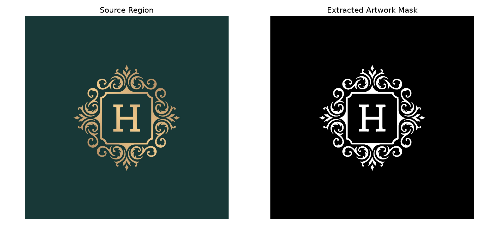

# Monogram Vector Extractor

A Python command-line tool for extracting monograms and logo artwork from raster images and converting them into scalable SVG graphics, favicons, and UI-ready preview assets.

The tool identifies bright or warm-coloured foreground artwork against a darker background, extracts its shape, traces its contours, and generates a reusable set of brand assets.

## Visual Example

| Original Image | Extracted Artwork |
|:---:|:---:|
|  |  |

## Features

- **Foreground Extraction:** Isolates bright or warm-coloured artwork, including gold, silver, and white, from darker backgrounds.
- **Adjustable Thresholds:** Fine-tune brightness and colour warmth to improve extraction accuracy.
- **Region Cropping:** Process an entire image or specify a rectangular region using crop coordinates.
- **Vector Tracing:** Converts extracted artwork into scalable SVG paths.
- **Custom Brand Colours:** Choose foreground and background colours for generated assets.
- **SVG Export:** Generates transparent SVG files suitable for different background themes.
- **Favicon Generation:** Creates SVG and PNG favicons in multiple resolutions.
- **UI Previews:** Exports PNG previews for light and dark interface themes.
- **Extraction Diagnostics:** Saves intermediate masks and comparison images to help inspect extraction quality.

## Requirements

- Python 3.10 or newer
- Dependencies listed in `requirements.txt`

## Installation

Clone the repository:

```bash
git clone https://github.com/seemadri/monogram-vector-extractor.git
cd monogram-vector-extractor
```

Create and activate a virtual environment:

**macOS / Linux**

```bash
python3 -m venv .venv
source .venv/bin/activate
```

**Windows**

```bash
python -m venv .venv
.venv\Scripts\activate
```

Install the dependencies:

```bash
pip install -r requirements.txt
```

### CairoSVG system dependency

CairoSVG may require the Cairo graphics library to be installed on your system.

On macOS:

```bash
brew install cairo
```

On Ubuntu/Debian:

```bash
sudo apt-get install libcairo2
```

## Quick Start

Run the extractor using the included example image:

```bash
python extract_monogram.py examples/sample_showcase.png --crop 56 159 381 451
```

Generated assets are saved in the `brand_assets/` directory by default.

## Usage Examples

### 1. Preview extraction before generating vectors

Inspect the extracted foreground mask before exporting the final assets:

```bash
python extract_monogram.py examples/sample_showcase.png \
  --crop 56 159 381 451 \
  --preview-only
```

This generates diagnostic images without exporting SVGs or favicons.

### 2. Customise brand colours

Specify foreground and background colours:

```bash
python extract_monogram.py examples/sample_showcase.png \
  --fg-color "#D9BE83" \
  --bg-color "#163E2B" \
  --prefix "mybrand" \
  --output dist/assets
```

### 3. Extract white or neutral-coloured artwork

For white or silver artwork, disable the warmth filter:

```bash
python extract_monogram.py white_logo.png \
  --warmth 0 \
  --min-brightness 180
```

### 4. Extract gold or warm-coloured artwork

Use the default warmth filter or adjust it to suit the input image:

```bash
python extract_monogram.py gold_logo.png \
  --warmth 35 \
  --min-brightness 105
```

### 5. Process an image without cropping

```bash
python extract_monogram.py logo.png
```

## Generated Assets

The default output directory is `brand_assets/`.

For a prefix of `monogram`, the tool generates:

### Vector Graphics

| File | Description |
|---|---|
| `monogram.svg` | Primary foreground-coloured transparent SVG |
| `monogram-dark.svg` | Foreground-coloured SVG for dark backgrounds |
| `monogram-light.svg` | Background-coloured SVG for light backgrounds |
| `monogram-favicon.svg` | Rounded-square favicon with a solid background |

### Favicon PNGs

The tool generates anti-aliased PNG favicons at:

- 16 × 16 px
- 32 × 32 px
- 64 × 64 px
- 192 × 192 px
- 512 × 512 px

### UI Preview Images

| File | Description |
|---|---|
| `monogram-preview-dark.png` | Preview for dark-theme interfaces |
| `monogram-preview-light.png` | Preview for light-theme interfaces |

Both previews are generated at 152 × 152 px.

### Diagnostic Images

The extraction process also generates intermediate images:

| File | Description |
|---|---|
| `01_source_crop.png` | Cropped source image (only when `--crop` is specified) |
| `02_extraction_mask.png` | Binary foreground extraction mask |
| `03_extraction_comparison.png` | Side-by-side source and mask comparison |
| `04_tight_mask.png` | Tightly cropped foreground mask |

The diagnostic images are useful for checking extraction quality and adjusting thresholds.

## Command-Line Reference

| Argument | Default | Description |
|---|---|---|
| `input` | Required | Path to the source image |
| `-o`, `--output` | `brand_assets` | Output directory |
| `-p`, `--prefix` | `monogram` | Filename prefix for generated assets |
| `--crop` | None | Optional crop coordinates: `LEFT TOP RIGHT BOTTOM` |
| `--fg-color` | `#D9BE83` | Foreground colour for primary and dark-theme artwork |
| `--bg-color` | `#163E2B` | Background colour for light-theme artwork and favicon backgrounds |
| `--min-brightness` | `105` | Minimum average RGB brightness threshold (0–255) |
| `--warmth` | `35` | Minimum red-blue difference for warm-coloured artwork (0–255); set to `0` to disable the warmth filter |
| `--preview-only` | False | Generate extraction diagnostics without exporting vectors |

## How It Works

The extraction pipeline consists of the following stages:

1. **Image Loading:** Loads the input raster image and optionally crops the specified region.
2. **Foreground Detection:** Identifies pixels using configurable brightness and colour warmth thresholds.
3. **Mask Cleaning:** Removes small isolated foreground components based on connected-component area.
4. **Tight Cropping:** Crops the extracted mask to the detected artwork boundaries.
5. **Contour Tracing:** Identifies and simplifies contours to create SVG paths.
6. **Asset Generation:** Exports transparent SVGs, favicons, and UI preview images.

## Troubleshooting

**The extracted artwork is incomplete**

Try lowering `--min-brightness` or `--warmth`.

**The extraction includes unwanted background pixels**

Try increasing `--min-brightness` or `--warmth`, depending on the foreground colour.

**White artwork is not detected**

Use `--warmth 0` to disable the warm-colour filter and adjust `--min-brightness` as needed.

**The output contains unwanted noise**

Increase the minimum brightness threshold or use a more tightly defined crop region.

**CairoSVG fails during PNG generation**

Check that the Cairo graphics library is installed on your system.

## Limitations

- The extraction method is threshold-based and works best when foreground artwork has sufficient brightness or colour contrast against its background.
- Complex backgrounds, gradients, shadows, and overlapping colours may require manual cropping or threshold adjustment.
- The generated SVGs are vector traces of the extracted raster artwork; they are not reconstructed from the original font or design geometry.

## License

MIT License.

See [LICENSE](LICENSE) for details.
